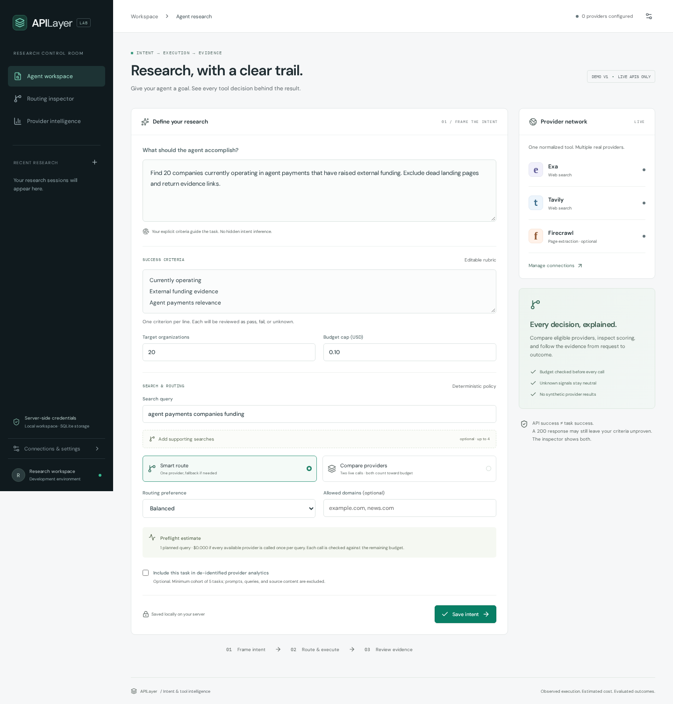

# APILayer

An intent-aware research workspace: route real web searches across Exa and Tavily, inspect every routing decision, review company evidence, and measure cross-provider outcomes.

Built from the **Agent Intent & Tool Intelligence Demo V1 PRD**. The repository started as an empty README. This implementation includes the three product screens and an executable backend; vendor credentials and live acceptance runs are still required.



## Run locally

Requires **Node.js 24.5+** (uses built-in SQLite).

```bash
npm ci
cp .env.example .env
# Add EXA_API_KEY and TAVILY_API_KEY to .env. Firecrawl is optional.
npm run build
npm start
```

Open **http://127.0.0.1:3001**. With no keys, the app still saves intent, shows the inspector, and explains setup. It does **not** synthesize research or fill analytics with invented performance data.

For development, `npm run dev` starts the API on port 3001 and Vite on **http://127.0.0.1:5173**. Provider credentials stay in the Node process; never use `VITE_` environment variables for them.

## What works

- **Agent workspace:** editable intent and rubric, target organization count, domain restrictions, explicit budget, up to five ordered search queries, follow-up searches, and optional analytics consent.
- **Live adapters:** Exa and Tavily search normalized into common sources; optional Firecrawl v2 page extraction as a separate capability. Keys present in configuration are labeled configured; access is only verified by an actual call.
- **Deterministic routing:** capability eligibility, credential availability, estimated cost, observed latency/reliability, and fully reviewed outcome quality. Missing observations stay neutral and are flagged. Balanced, cost, and latency profiles are selectable.
- **Budget controls:** integer USD micro-units, transactional reservation before each paid attempt, conservative settlement on errors/timeouts, task cap of 50 attempts, provider request limits, and a maximum of three active tasks. Compare mode explicitly opts into both paid search providers.
- **Trace inspector:** append-only task/call events, candidate scores and exclusions, selected reasons, credential-redacted request arguments, response metadata, vendor-reported usage when available, budget ledger, fallback decisions, and human feedback.
- **Evidence review:** pass/fail/unknown per criterion, different evidence links for different criteria, accepted/rejected/pending findings, deduplicated organization shortlist, and spreadsheet-safe CSV export.
- **Provider intelligence:** only opted-in task aggregates; at least five contributing tasks before reporting and separate provider cohort suppression. No raw prompts, queries, evidence text, organization names, or source URLs in the analytics response.
- **Persistence and recovery:** local SQLite with WAL, restart reconciliation of in-flight estimates, graceful draining, a retention command, and sanitized trace exports.

The controlled agent executes an **explicit user-supplied plan**. It is not an autonomous LLM researcher. Search evidence is never automatically asserted to prove funding, activity, or relevance. HTTP success, evidence coverage, and human-reviewed task completion are separate observations.

## A useful demo

1. Configure both search keys and start the app.
2. Save the default agent-payments intent. Review the criteria, budget, and query before executing.
3. Choose automatic routing or explicitly opt into comparison. Supporting searches run sequentially under the same budget.
4. Run live research. Open **Routing inspector** and expand candidates and response events.
5. A 200 response can still fail the basic evidence coverage check and trigger the other provider. If live responses are similar, report that honestly; never manufacture a quality difference.
6. Review sources. Name the organization, choose pass/fail/unknown, link evidence to each criterion, and write an evidence note. Acceptance requires every criterion to pass.
7. Export your reviewed company shortlist, or share a **sanitized** trace without task content.
8. Analytics unlock after five opted-in tasks; small provider cohorts remain withheld.

See [demo and validation status](docs/VALIDATION.md), [architecture and routing](docs/ARCHITECTURE.md), [API contract](docs/API.md), and [privacy/operations](docs/OPERATIONS.md).

## Verification

```bash
npm run check                # strict TypeScript, production builds, unit/integration tests
npx playwright install chromium
npm run test:e2e             # desktop/mobile workflows, accessibility checks, screenshots
npm run format:check
```

The tests use isolated, explicitly labeled fixtures. The production entry point does not import them, expose a fixture mode, or accept custom provider endpoints. Test credentials never authorize external API calls.

For the PRD's **10 real calls to each provider** acceptance check, after reviewing your provider pricing:

```bash
npm run build
LIVE_VALIDATION_BUDGET_USD=0.25 npm run smoke:live
```

Stop the workspace server before running this direct-database check, then restart it to inspect the task. This command **makes paid calls**. It requires both real keys and an explicit cap sufficient for the configured estimates (default total $0.230). It stores an inspectable validation task, excludes it from provider analytics, and fails unless both providers produce ten successful responses. It has not been run in an environment without provider keys.

## Deployment

The default is a single-user, local workspace. Set a long `API_TOKEN` before binding beyond loopback. The UI's Connections dialog accepts that workspace token in memory only. Use HTTPS for any remote deployment and keep this service behind trusted access controls.

A non-root, multi-stage `Dockerfile` is included. Pass `API_TOKEN` (24+ characters), provider keys, and a persistent volume at `/app/data`; publish port 3001 behind HTTPS. `/healthz` is a minimal unauthenticated liveness endpoint. `/api/*` requires the token when configured.

Run **one server process per SQLite database**. This version has a shared workspace token, not tenant isolation or per-user authorization. Avoid exposing it as a public SaaS service. All prices are configurable estimates, not vendor invoices; the hard budget applies to that estimate ledger. Set vendor-side spending limits as well.

No x402, wallet custody, insurance claims, fabricated revenue, or provider willingness-to-pay assertions are included.
