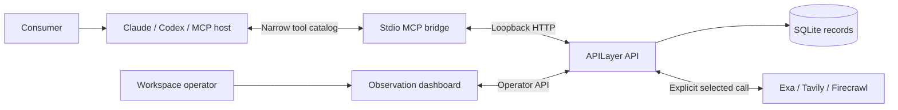

# Observation architecture

APILayer is a local observation and evaluation layer. Claude, Codex, or another MCP host owns the consumer conversation and chooses tools. The backend authorizes MCP sessions automatically and supplies their estimated spending cap. The operator dashboard inspects evidence and reviews outcomes; it also retains a separate manual intent-acceptance flow.

The bridge never opens the database. A single HTTP process owns SQLite and provider admission. Existing research remains under `/research/`, with its earlier deterministic routing clearly separated from external-agent decisions.

## Record lifecycle

1. The agent records an objective, distinct weighted criteria, constraints, and optional reported model/host. The backend supplies `AGENT_SESSION_BUDGET_MICROS`; neither the MCP schema nor its agent-session endpoint accepts a budget override. The objective, criterion IDs/text/weights, constraints, and backend cap are hashed together. A consumer's shopping budget stays in the task constraints.
2. Creation atomically stores the session, an agent-reported `intent_recorded` event, and an observed `intent_authorized` event with the backend policy and cap. The session is immediately active, with `authorizationSource: backend_policy`; no consumer approval is required. Separately, operator-created sessions and legacy proposals retain manual acceptance of the exact hash. That acceptance is idempotent, rejects mismatches, and records `workspace_operator` as its source. Existing pending proposals are not silently authorized.
3. Discovery records the options returned at that moment, including configured prices and local performance samples. It does not select a tool or establish which options the agent considered.
4. The agent explicitly invokes a named provider. A transaction checks authorization, configuration, rate/call limits, and remaining estimated budget; it records a request key and reserves the estimate before network I/O.
5. The settled call records timing, API status, page status where available, returned evidence, and the configured estimate. An optional selection explanation is a separate agent-reported event.
6. The agent submits its actual final output and supporting call IDs. Outputs are versioned and linked to the accepted intent. Submission does not verify success.
7. An operator evaluates every criterion as pass, fail, or unknown, with a note and optional evidence references. Each evaluation binds an exact output ID and intent hash. A historical review requires explicit intent and never replaces the latest output's score.
8. A review case can reference any recorded evaluation. Opening/resolving a case records evidence and a decision, without issuing a refund, payment, or insurance coverage.

The state label is a workflow convenience: active, completed, or evaluated, with awaiting approval retained for the manual operator flow. A later call can reopen activity; a new submitted version requires its own evaluation. Prior versions and reviews remain available. The existing `approvedAt` storage field holds either authorization timestamp; the separate authorization source and event provenance identify which path occurred.

## Retry and recovery semantics

Provider request keys are unique within a session. The signature covers tool, normalized arguments, and supplied explanation. Identical replays return the existing receipt; changed arguments with the same key fail. An in-flight replay returns a running receipt rather than another provider request. A new operation needs a new key.

Output submissions have independent idempotency keys. A replay returns the original output version even after a newer version was submitted. Evaluation and case writes append records and do not currently expose client idempotency keys; clients should refresh after an uncertain response before submitting again.

On an unclean process termination, startup marks outstanding calls interrupted and conservatively consumes their reserved estimates once. It does not assume the vendor failed or silently repeat a potentially billed operation. A cached evidence read never invokes a provider.

## Evaluation semantics

- Score = passed weight / known weight. Failed criteria count as known; unknown criteria do not count as a pass or failure.
- Coverage = known weight / total accepted weight. A 100% score at 50% coverage is not full fulfillment.
- An all-unknown review has a null score and zero coverage.
- Model summaries use the latest evaluation of the latest output per session. They require at least five fully reviewed sessions before displaying a local aggregate score, and never score the `Not reported` model group.
- These are task-specific workspace reviews, not a general model benchmark. Reviewer kind and model identity are reported, not authenticated or independently attested. Assistant-written reviews are visibly labeled.
- Provider quality remains unknown. Local HTTP success and latency are execution measurements, not accuracy or task success.

## API surface

All routes below live under `/api/observations`, inherit workspace token/origin/host checks, and use a 160 KB JSON request limit.

| Route                                        | Behavior                                                                               |
| -------------------------------------------- | -------------------------------------------------------------------------------------- |
| `GET /`                                      | Session list with output/evaluation metadata, without full output text or review notes |
| `POST /agent-sessions`                       | Agent-reported intent, automatically authorized under backend spending policy          |
| `POST /` / `POST /proposals`                 | Manual operator intent / legacy agent proposal, awaiting operator acceptance           |
| `GET /summary`, `/catalog`, `/aggregate`     | Local summaries, tools, and consented cohort statistics                                |
| `GET/POST /connection`                       | Last-observed client name/version; not a live heartbeat                                |
| `GET /:id`                                   | Private session, evidence, events, and chain consistency                               |
| `POST /:id/approve`                          | Accept exact intent hash                                                               |
| `POST /:id/discover`                         | Record offered tool set                                                                |
| `POST /:id/call`                             | Execute explicit tool with request key                                                 |
| `GET /:id/calls/:callId`                     | Read a cached receipt scoped to this session                                           |
| `POST /:id/outcome`                          | Versioned output submission                                                            |
| `POST /:id/evaluate`                         | Criterion review; explicit `historical: true` for prior output                         |
| `POST /:id/cases`, `POST /:id/cases/:caseId` | Open and resolve/dismiss a review case                                                 |
| `POST /:id/consent`                          | Change optional commercial aggregate consent                                           |
| `GET /:id/export`                            | Content-minimized summary export                                                       |
| `POST /:id/delete`                           | Delete local records after confirming the session ID; blocked during active calls      |

Schemas and validation live in `server/observation.ts`; protocol tool definitions in `server/mcp-server.ts`. [MCP setup](MCP.md) describes the agent-facing subset.

## Offline evidence verification

`npm run verify:evidence -- /path/to/private-evidence.json` checks a private export without contacting the API or any provider. It recomputes the accepted-intent fingerprint and event chain, verifies the matching backend-policy authorization or operator-acceptance event, compares materialized source/output/review content against recorded events, checks evidence and case references, reconciles the estimated ledger, and compares the current consent flag with its last event. Backend budget data comes from the observed authorization event, not an invented agent report. A summary export intentionally omits the necessary private content and cannot pass this check.

Exit codes are 0 for consistent records, 1 for inconsistencies, and 2 for an unreadable/invalid JSON input. The report contains identifiers and error descriptions, not the research text. Informational timestamps and display labels are not externally authenticated. An export of unfinished work can be internally consistent; passing does not mean the task succeeded or the source claims are true.

## Boundaries and next steps

MCP does not expose private reasoning, the host's complete conversation, or outside tool calls. APILayer records only what reaches its own tools. The local event chain detects chain inconsistency but is not external custody or protection against a database owner rewriting the whole record. Provider content is untrusted, extraction text may be partial, and model/client/reviewer identities are reported.

Before a commercial scoring or refund product: add authenticated principal identities, external evidence attestation, a reproducible evaluation protocol with independent review, verified price/usage reconciliation, and a separately defined claims/payment contract. Before vendor analytics: define consent and licensing for every exported field, cohort and privacy protections, and a buyer-facing export boundary. Those are future product capabilities, not claims made by this implementation.
